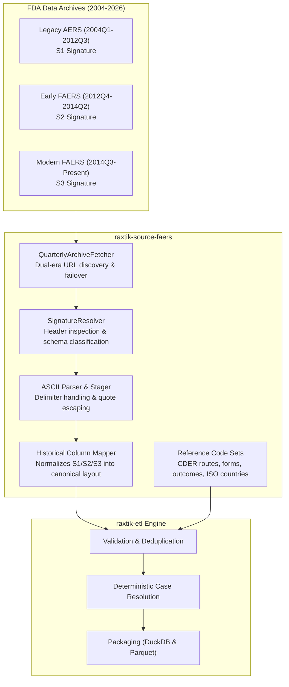

# Architecture & Schema Signatures

`raxtik-source-faers` implements the `SourceAdapter` protocol, isolating all FDA-specific archive layouts, ASCII file anomalies, and historical schema evolution from the canonical `raxtik-etl` engine.

---

## 🏛️ Decoupled Plugin Architecture

---

## 🔍 Historical FDA Signatures (Fail-Closed)

Over the past 22 years, the FDA has modified ASCII archive structures, table delimiters, and primary key conventions across three distinct eras:

| Era | Signature | Temporal Coverage | Delimiter | Primary Key Column | Case Identifier |
| :--- | :---: | :---: | :---: | :---: | :---: |
| **Legacy AERS** | **`S1`** | 2004Q1 – 2012Q3 | `$` / comma | `isr` | `case` |
| **Early FAERS** | **`S2`** | 2012Q4 – 2014Q2 | `$` | `primaryid` | `caseid` |
| **Modern FAERS** | **`S3`** | 2014Q3 – Present | `$` | `primaryid` | `caseid` |

### Fail-Closed Validation
The parser inspects the header row of all 7 raw ASCII files before processing:
- If all expected columns match a recognized signature (`S1`, `S2`, or `S3`), extraction proceeds using the appropriate schema mapper.
- If any required column is missing, or if an unrecognized column layout is detected, the adapter raises an immediate `ValueError` and halts execution. Corrupted or unverified data is never loaded into the pipeline.

---

## 🛠️ Handling ASCII Quirks

1. **Embedded Delimiters**: Some drug brand names or indication descriptions contain embedded `$` characters. The parser utilizes regex-based field splitting aligned with the expected column count.
2. **Missing Demographic Links**: In multi-quarter surveillance updates, child records (`drug`, `reac`, `indi`, `ther`) occasionally reference a `primary_id` from a prior quarter. The adapter stages these records while reporting referential integrity counts.
3. **Date Standardization**: FDA date fields (`fda_dt`, `mfr_dt`, `start_dt`, `end_dt`) appear in varied formats (`YYYYMMDD`, `YYYYMM`, `YYYY`). The adapter normalizes all dates to ISO-8601 (`YYYY-MM-DD`).

